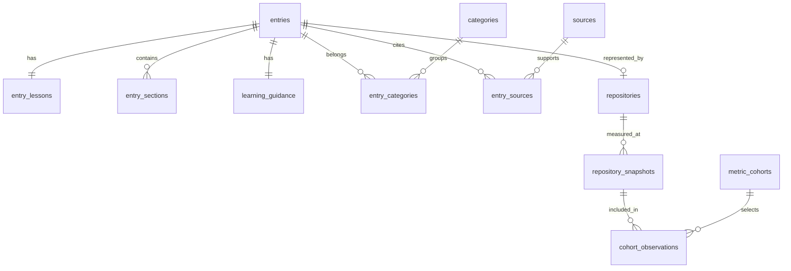

# מפת הנתונים הפעילים

עודכן: 2026-10-31. כל הטבלאות הבאות בסכמה academy. שמות הטבלאות והשדות באנגלית; התוכן הלימודי בעברית. nullable מציין מידע שחסר או אינו חל, ולא ערך שהושלם בהשערה.

## פריט הידע והתוכן
| טבלה | אחריות ושדות מרכזיים |
|---|---|
| entries | זהות: id קבוע, slug לכתובת, name, kind. summary הוא תקציר הפרק. publication_status נפרד מ־verification_status. verified_at, revision ו־revision_note מתעדים את המצב הנוכחי; אין עותק JSON של הפריט. added_at ותאריכי גילוי/אישור נפרדים מהשקת המוצר |
| entry_lessons | פריט אחד לפרק: prerequisites, example, exercise, language_support_note, alternatives_note |
| entry_sections | סעיפי הפרק: entry_id, position, title, body. position שומר סדר קריאה |
| learning_guidance | מקור יחיד לעדיפות הלימוד: priority, reason, reviewed_at, basis. זו המלצה פדגוגית ולא מדד שוק |
| categories | 12 תחומים עם id קבוע 00–11, name ותיאור |
| entry_categories | שיוכים רבים לרבים; entry_id, category_id וסדר position. מזהים חוזרים בקשרים אינם עותק של פרטי הכלי |
| entry_relations | קישורי המשך לפריטים באמצעות related_entry_id, ולא העתקי שמות או פרקים |

## עובדות, שפות ומקורות
| טבלה | אחריות ושדות מרכזיים |
|---|---|
| catalog_facts | description קצר לטבלה, language_support_summary, repository_status/note כשאין מאגר מייצג, reviewed_at. התיאור הקצר אינו עותק JSON או תקציר הפרק המלא; יש נוסח קטלוג פעיל אחד |
| entry_language_labels | תוויות תצוגה מסודרות: למשל Python או HTTP API. אין הסקת SDK מקומי מתוך API |
| entry_releases | release_year; release_date רק אם יום מדויק אומת; precision, source_url, note. אין תאריך מלא מומצא כשהמקור מספק שנה בלבד |
| sources | כתובת URL ייחודית לכל מקור. פרטי הטענה והתאריך נמצאים בקשר הרלוונטי |
| entry_sources | שיוך מקור לפרק: source_url, title, supports, checked_at ו־position. מקור יכול לתמוך בכמה פרקים או טענות |

## מדדים ומדידות לאורך זמן
| טבלה | אחריות ושדות מרכזיים |
|---|---|
| repositories | כתובת מאגר ייחודית, entry_id של הפריט שהוא מייצג, scope_note שמסביר מה נמדד |
| repository_snapshots | מפתח: repository_url + collected_at. stars, forks, source_url, last_activity_at ומקור/שיטת פעילות. forks חסר נשאר NULL. אותו מאגר במועדים שונים הוא היסטוריית מדידות |
| metric_methods | הגדרות שיטות: id, name, formula, מקור והערה. GitHub Interest, SourceRank ו־npms נשארים מדדים נפרדים |
| metric_cohorts | המדגמים של 7 מאגרי 02 ושל 3 מנועי 08; לכל מדגם שיטה וזהות קבועה |
| cohort_observations | מפנה למדידת מאגר ומועד ספציפיים; אינו שומר Stars/Forks שוב |
| package_metrics | מדידות חבילות חיצוניות: value, request_status, source_url, collected_at, measured_at, פרטי חבילה וסיבת חוסר. נתוני npms ההיסטוריים אינם מוצגים כמדידת שימוש עכשווית |

מדד OSS Compass שלא חושב נשמר כהגדרת שיטה עם סיבת החוסר; אין שורות ציונים מומצאות לכל כלי. ראיות לניסיונות מחקר שנכשלו נשמרות במסמך המקור הארכיוני, ואינן טבלאות קטלוג לעריכה.

## מדריכים והצעות
| טבלה | אחריות ושדות מרכזיים |
|---|---|
| category_guides | title, introduction, note לכל קטגוריה שיש לה מדריך |
| category_guide_steps | שלבים מסודרים: instruction, link_label ו־entry_id של יעד הקריאה |
| research_proposals | שדות מפורשים: kind, status, current_value, proposed_value, rationale, tradeoffs, confidence ותאריכי מחקר/החלטה. כרגע ריקה. proposed_value הוא תיאור הצעה, לא עותק JSON של הקטלוג |
| proposal_sources | ראיות להצעה, סוג המקור והטענה הנתמכת |
| proposal_categories | שיוך הצעה לקטגוריות קיימות |
| schema_migrations | גרסאות שינויי הסכמה שבוצעו; זו אינה גרסת תוכן של כלי |

אישור אנושי אמיתי ממשיך להידרש. אילוץ SQL יכול לדרוש הפניה להחלטה, אבל אינו מוכיח שהאישור ניתן. תהליך המחקר הפעיל עדיין בקבצים; חיבורו לטבלאות מחייב שלב נוסף.

## תצוגות לקריאה
- catalog: חיבור נוח של פריט, תיאור קטלוג והמלצת לימוד. מתאים לסקירה בממשק Supabase.
- entry_documents: ייצוא JSON שמחושב מהטבלאות לצורך התאמה לאפליקציה. JSON זה אינו עמודה שמורה נוספת.
- community_interest: חישוב יחסי של ציון לכל מדגם ומועד, מהמדידות הקיימות. אין עותק ציון נוסף לעריכה.

academy_import_archive נפרדת מכל אלה: צילום הייבוא המקורי וגרסאות תיאור שהוחלפו, מוגנים מעריכה שוטפת. אין להשתמש בארכיון כמקור נתונים פעיל. החזקת צילום היסטורי היא לצורך התאוששות; אין בו מקום שני לעדכון העובדות הנוכחיות.

## סקרי שימוש מפתחים — מיגרציה 005
| טבלה | משמעות |
|---|---|
| developer_surveys | שנה, שם ומקור הסקר (FK ל־sources), נוסח השאלה, אוכלוסייה, מספר משיבים, בחירה מרובה, רישיון ותאריך אימות המקור |
| entry_survey_usage | ספק כפי ששמו מופיע בסקר, אחוז שימוש מדווח 0–100, ספירת משיבים, הערת מיפוי ו־FK לסקר ולפריט הידע; רשומה אחת לפריט בכל סקר |

אלה שיעורי שימוש בקרב משיבי השאלה, לא נתח שוק, לא שיעור מכל המפתחים ולא ציון פופולריות. ה־Loader מצרף את שנת הסקר העדכנית לכל פריט בנפרד. מיפוי 2026 כולל שבע משפחות מודלים; אין ייחוס של ספק כללי לפלטפורמת ענן/גישה.

## מחזור חיים — מיגרציה 006
entry_lifecycle: entry_id (PK/FK לפריט), status=legacy, note להסבר ו־successor_entry_id כמפתח זר לפריט המחליף; הפניה עצמית חסומה. היעדר רשומה פירושו שלא הוגדר סימון Legacy. אין קשר בין Legacy להסתרה/מחיקה: AutoGen מפורסמת כהיסטוריה ומפנה ל־Microsoft Agent Framework. RLS פעיל ואין הרשאות ציבוריות. ה־Loader מצרף lifecycle לקריאת פרק לצד entry_documents; אין עמודת JSON בטבלאות הפעילות.

## היסטוריה שאינה מפורסמת — מיגרציה010
publication_status=archived ב־academy.entries משמש כעת ל־flowise ול־openai-agent-builder. תוכנן והראיות נשמרים בטבלאות המנורמלות אך ה־loader מסנן אותן מהאתר. זה אינו academy_import_archive ואינו מצב legacy המחייב successor. אין להמציא מחליפה כדי לסמן EOL; אין להחליף archived ב־published כדי להציג היסטוריה ללא החלטת מוצר.

## מחזור חיים מורחב — מיגרציה011 (מחליף את מדיניות החשיפה לעיל)
entry_lifecycle.status: legacy=דור קודם/הוצא משימוש, maintenance=תחזוקה מוגבלת ואינה הפסקה, discontinued=הפסקה רשמית מאומתת. note היא סיבה; successor_entry_id אופציונלי ואינו נדרש כשאין מחליפה רשמית. source_url ו־checked_at שומרים ראיה ומועד אימות; effective_at ו־date_label מגדירים איזה אירוע מתואר; scheduled_end_at הוא מועד מתוכנן בלבד. Discontinued מחייב מקור ותאריך; אין ניחוש לפי גיל פעילות.
רשומה published עם lifecycle מופרדת מההמלצות. archived עם lifecycle נחשפת כהיסטוריה, ו־archived לא מסווגת נשארת מוסתרת. publication_status אינו מצב תחזוקה. Flowise/Agent Builder נשארו archived אך נגישות במדור ההיסטורי ובחיפוש; AutoGen שומרת published/Legacy. sources ונתוני תוכן קיימים לא שוכפלו.
